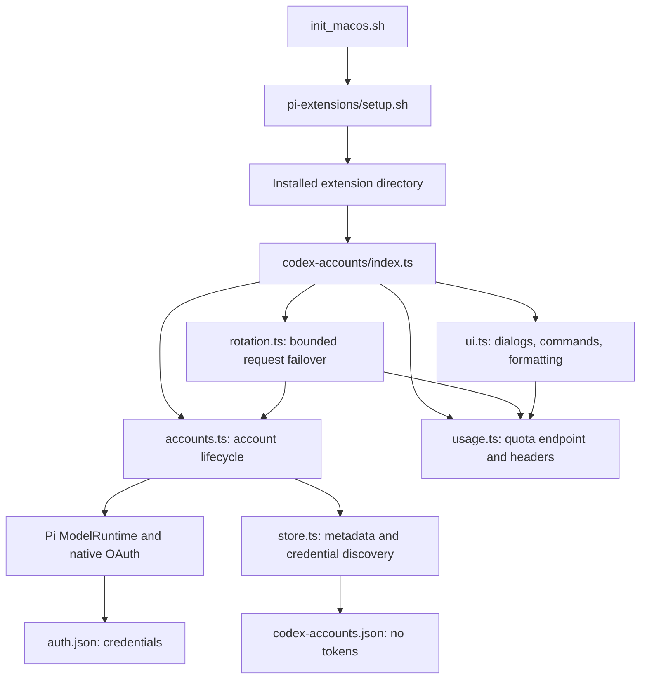

# Fresh macOS setup architecture

## Purpose

Install a macOS development environment and distribute Pi skills and extensions from this repository.

## Scope and Assumptions

Verified on 2026-10-11 against `README.md`, installer entry points, and the Codex accounts extension. This document describes installer boundaries and the Codex subsystem; it does not audit every bundled extension. Codex integration targets Pi 1.1.0 and Node 22. No `src/` directory or `pyproject.toml` was found; entry points are Bash scripts and Pi extension factories.

## System Overview

`init_macos.sh` delegates Pi resource installation to category scripts. `pi-extensions/setup.sh` copies selected files/directories into the agent directory and records hashes to avoid overwriting local edits. Pi later loads an extension's `index.ts`. The Codex extension overrides the native `openai-codex` provider while keeping its OAuth flow and model catalog.

## Architecture Diagram

## Runtime Entry Points

- `init_macos.sh`: setup categories and dry-run handling.
- `pi-extensions/setup.sh`: extension installer, source descriptions in `pi-extensions/manifest.tsv`.
- `pi-skills/setup.sh`: skill installer.
- `pi-extensions/extensions/codex-accounts/index.ts`: asynchronous Pi extension factory, `/codex` and `/codex-usage`, session lifecycle events.
- `pi-extensions/extensions/codex-accounts/tests/`: Node test runner fixtures. Network responses and OAuth approval are fake; credentials use temporary directories.

## Architectural Layers

- Installer scripts depend on `lib/installer-ui.sh` for selection and confirmation.
- `index.ts` registers the provider and coordinates commands, quota polling, lifecycle cleanup and recovery of account-specific model selections. Recovery refreshes the native auth availability snapshot and moves the selection to `openai-codex` without changing the model ID.
- `accounts.ts` depends on Pi's public credential runtime and native provider. It owns account archiving, removal, defaults and one-time repair.
- `rotation.ts` depends on `accounts.ts` and quota parsing. It wraps native event streams without changing the selected model or transcript.
- `store.ts` reads credentials, discovers account identities and writes metadata only. It imports Pi credential types but does not own OAuth.
- `usage.ts` parses quotas, calculates availability and fetches the usage endpoint. It depends on store types.
- `ui.ts` formats picker rows, footer text, reports and command completions. It depends on store types and quota calculations, not network or credential writes.

## External Integrations

- Pi's mapped `@earendil-works/pi-coding-agent` and `@earendil-works/pi-ai` entry points provide provider registration, ModelRuntime, OAuth and event streams.
- The native OpenAI OAuth implementation owns browser/device sign-in and refresh.
- Native Codex streaming owns SSE/WebSocket transport and transcript conversion.
- `https://chatgpt.com/backend-api/wham/usage` supplies remaining quota inputs and reset timestamps. Access requires the selected account's refreshed token and account ID.

## Core Data Flow (Current)

1. Loading discovers existing credentials and metadata. A one-time repair restores a missing core credential through Pi's locked operations. It does not replace a valid core credential or rewrite settings. Session startup, reload and model selection repair known account-specific model selections. An input handler also repairs them after native login, before Pi's auth preflight. Virtual alias registration alone cannot guarantee that an old physical model object is replaced.
2. `/login` and `/codex add` use the same native OAuth method. A different previous account moves into a private credential slot before Pi replaces the core login. If archiving fails after approval, a retry/cancel dialog retains the pending credential in memory. Retrying reuses that approval and re-reads the previous credential; cancellation does not replace the previous core login. The newly signed-in account remains in `openai-codex` after successful persistence.
3. A request selects the session preference, current account or default, skipping known exhaustion in either quota window. Unknown quota remains eligible but is not counted as confirmed ready.
4. Native OAuth refresh runs through Pi's credential store lock. The stream wrapper supplies the chosen account token while preserving model, transcript and callbacks.
5. A proven quota error before content tries another account. Partial text, thinking, tool calls, authentication errors, cancellation and generic throttling do not trigger account replay. Normal transient retries stay native.
6. Header snapshots and bounded usage polling update metadata. TUI polling covers all accounts. Session replacement aborts the previous lifecycle so old dialogs and reports cannot affect the new session. Shutdown also aborts extension-initiated sign-in and clears the timer.

## Module Ownership Boundaries

Pi owns `auth.json` writes, locking and OAuth refresh. The extension owns `codex-accounts.json`, with a separate metadata-only lock and restrictive file permissions. The native core slot remains usable when the extension is disabled. Archived providers belong to the helper runtime and never register another OAuth login in the main runtime. Only upgraded installations retain legacy virtual aliases.

Setting a default changes future sessions. Switching changes this session and selects a normal Codex model when needed. UI notifications and quota display failures must not abort native requests. Recovery contains storage/registry failures and warns once per session so startup still arms quota polling. Native request callback failures remain visible to callers. Archiving is a credential-preservation requirement, not optional metadata; failures require retry or cancellation rather than silent account replacement.

## Architecture Change Protocol

Document changes to provider identity, credential ownership or failover semantics in this architecture document. Keep native credential operations separate from metadata writes. Run the offline suite before installation and verify that normal Codex auth still works without the extension. Installer overwrite rules remain independent of authentication behavior.

## Future Clarifications

- Live browser/device approval, terminal rendering and WebSocket failover still require interactive verification.
- Concurrent login/logout across Pi processes spans separate native transactions and is unsupported. A revoked core token can fail native authentication before routing; reauthentication is required.
- Pi 1.1.0 lists keyless virtual providers as API-key placeholders. Legacy aliases provide no login method; use the native Codex OAuth entry or `/codex`.
- A process crash can leave the metadata lock directory behind. Remove it only after checking no Pi process is using it. This lock never protects native credentials.
- Model availability varies by ChatGPT plan. Unsupported models report the backend error rather than silently changing the chosen model.
